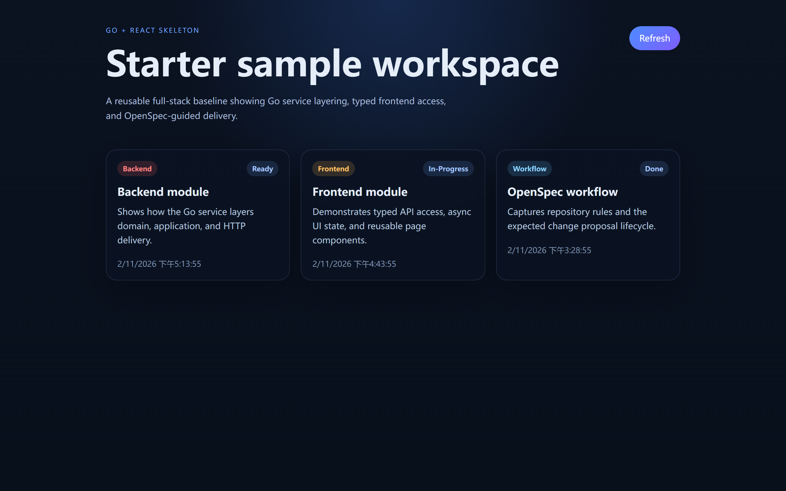

# Team Task Demo · AI 辅助编码工程化实战

**从一个能运行的 Go + React 项目出发，观察架构、规范、Skill 和测试怎样支持 AI 辅助开发。**

这是《AI 辅助编码工程化》的配套实战项目，采用 DDD 分层架构、OpenSpec 规范驱动和 Feature 工作流。可以直接阅读仓库里的规则、代码和脚本，运行项目，再选择一个小需求，与 AI 一起尝试完整的设计和交付过程。

项目地址：[toheart/team-task-demo](https://github.com/toheart/team-task-demo)。生成模板：[go-react-openspec-starter](https://github.com/toheart/go-react-openspec-starter)。

希望了解这些安排背后的取舍、每一步怎样操作，以及怎样迁移到自己的项目，可以在微信搜索公众号 **「小唐的技术日志」**，查看 **《AI 辅助编码工程化》付费课程**。仓库提供可阅读和运行的工程材料，配套课程进一步展开设计判断与实战解析。

## 当前进展

当前代码处于**第 14 课初始项目**阶段：已有样例首页、内存仓储、工程规范、Feature 工作流和系统 E2E 基础设施，尚未实现团队任务业务。

第 14 课固定版本：[lesson-14](https://github.com/toheart/team-task-demo/tree/lesson-14)。跟做本课时可以使用这个标签，后续功能更新继续在主分支推进。

后续实战安排为：第 15 课使用已有工作流完成功能开发，第 16 课使用系统 E2E 验收完整业务流程。目录中有测试入口，不代表所有业务旅程已经实现或验证通过。



上图为初始项目的实际运行页面。当前保留模板样例，卡片时间随服务启动而变化。

## 从代码中可以研究什么

| 关注的问题 | 建议先读 | 可以观察的做法 |
|---|---|---|
| AI 进入项目后先读什么 | [AGENTS.md](AGENTS.md)、[CLAUDE.md](CLAUDE.md) | 项目入口如何指向架构、规范、命令与工作流 |
| 多种 Agent 怎样共用 Skill | [.agents/skills](.agents/skills)、[同步脚本](scripts/sync-ide-skills.sh) | 维护一份源文件，再同步到不同工具的读取目录 |
| 需求怎样交接给实现 | [feature-design](.agents/skills/feature-design/SKILL.md)、[状态约定](openspec/docs/orchestrator-state-convention.md) | 设计材料、交接状态与确认点如何配合 |
| AI 写完代码后怎样检查 | [feature-exec](.agents/skills/feature-exec/SKILL.md)、[测试约定](docs/testing.md) | 测试设计、代码审查、执行证据与交付条件 |
| 架构怎样隔离存储方式 | [领域接口](backend/internal/domain/sample/sample.go)、[内存仓储](backend/internal/infrastructure/storage/memory/sample_repository.go)、[依赖装配](backend/internal/wire/container.go) | 应用层依赖接口，基础设施提供具体实现 |
| 怎样验收真实前后端流程 | [系统 E2E 说明](frontend/e2e/README.md) | 运行环境、用户旅程、断言与结果记录 |

一种阅读顺序是：先运行项目，再读 `AGENTS.md`，接着沿着「设计 → 执行 → 检查」查看 Skill，最后回到样例代码，理解流程中的规则怎样对应到实现。也可以把这些文件交给 AI，要求它结合具体路径解释设计依据，再人工核对。

## 环境准备

- Go 1.25.0 或能够获取对应版本的 Go 工具链，以 `backend/go.mod` 为准。
- Node.js 22.12+ 与 npm。
- Python 3.10+、Git、Make，以及已配置的 AI 编码工具和 OpenSpec CLI。

首次启动前，在 `frontend/` 安装锁定的依赖：

```powershell
cd frontend
npm ci
cd ..
```

## 启动项目

```bash
make dev    # 启动 backend(:8080) + frontend(:3000)
```

打开 `http://localhost:3000` 查看样例页面，后端健康检查为 `http://localhost:8080/healthz`，样例 API 为 `http://localhost:8080/api/v1/samples`。需要分别观察日志时，在项目根目录的两个终端执行 `make dev-backend` 和 `make dev-frontend`。

```powershell
python scripts/check-test-env.py qa
python scripts/orchestrator-state.py validate-structure
make check
```

Linux 中将上述 `python` 替换为 `python3`。`make check` 会执行格式化，运行后可通过 `git diff` 查看文件变化。

这些检查验证模板初始环境与基础质量，任务业务的系统 E2E 留在后续课程执行。

后端使用内存存储以减少环境依赖，无需先安装数据库；服务重启后，样例数据会重新初始化。需要持久化时，可以与 AI 一起尝试实现数据库仓储并调整装配，再通过集成测试验证数据库行为。

## 项目包含的能力

- **Go 后端**：Cobra CLI + Gin HTTP + Viper 配置 + `log/slog` 日志，DDD 四层分层
- **React 前端**：TypeScript + Vite，共享 API Service 层
- **OpenSpec**：`spec-driven-custom` schema（capability spec + L1/L2/L3 任务分级），4 套工程规范，context 自动注入
- **AI 工作流**：`$feature-design` / `$feature-exec` 编排 Skill，跨 IDE 共享 `.orchestrator/` 状态
- **系统 E2E**：`$system-e2e` 按需运行真实前后端旅程，Playwright 输出可追溯的业务结果
- **CI/CD**：GitHub Actions 流水线
- **容器化**：Dockerfile + docker-compose

## 项目结构

```text
├── Makefile                          # make dev / check
├── docker-compose.yml
├── AGENTS.md                         # 项目规则与 AI 工作流入口
├── CLAUDE.md                         # Claude Code 入口
├── .agents/skills/                   # Skill 源目录
├── .claude/agents/                   # Claude Code subagent 定义
├── .codex/agents/                    # Codex subagent 定义
├── scripts/
│   ├── orchestrator-state.py         # 设计/执行共享状态机
│   ├── check-test-env.py             # 测试环境检查
│   └── sync-ide-skills.*             # Skill 镜像同步
├── backend/
│   ├── Dockerfile
│   ├── Makefile
│   ├── cmd/                          # Cobra 入口
│   ├── conf/                         # Viper 配置
│   ├── etc/                          # YAML 配置文件
│   └── internal/
│       ├── domain/sample/            # 领域层
│       ├── application/sample/       # 应用层
│       ├── infrastructure/storage/   # 基础设施层
│       ├── interfaces/http/          # 接口层
│       ├── logging/
│       └── wire/                     # 依赖装配（手写工厂）
├── frontend/
│   ├── Dockerfile
│   ├── e2e/                        # Playwright 系统 Case、环境与结果
│   └── src/
│       ├── components/
│       ├── hooks/
│       ├── services/                 # API 调用层
│       └── types/
├── openspec/
│   ├── config.yaml                   # 项目上下文
│   ├── schemas/spec-driven-custom/   # 定制 artifact 模板与写作约束
│   ├── specs/                        # 工程规范
│   ├── docs/                         # 编排状态与 test-guides 约定
│   └── changes/_example/             # 格式示例
└── .github/workflows/ci.yml
```

## 常用命令

| 命令 | 用途 |
|---------|-------------|
| `make dev` | 启动前后端开发服务器 |
| `make check` | 执行后端格式化、lint、测试和构建，再执行前端 lint、测试和构建 |
| `make clean` | 清理构建产物 |

系统 E2E 的启动方式见 [frontend/e2e/README.md](frontend/e2e/README.md)；它不属于 `make check`。

## 使用已有 Feature 工作流

Codex 直接读取 `.agents/skills/`。Claude Code / Cursor 首次使用前，在项目根目录同步 Skill 投影：

Windows PowerShell：

```powershell
powershell -ExecutionPolicy Bypass -File scripts/sync-ide-skills.ps1 -Target all -Mode auto
```

Linux Bash（Bash 4+）：

```bash
bash scripts/sync-ide-skills.sh --target all --mode auto
```

`.agents/skills/` 是唯一源目录，`.claude/skills/` 和 `.cursor/skills/` 由脚本生成。修改 Skill 后重新同步，避免不同工具各自维护一份流程。

功能开发统一走两个编排 Skill：

```text
$feature-design <change-name>
  explore（按需）→ propose → design-review → gate-design → write-handoff

$feature-exec <change-name>
  test-design → implement → code-review → test-run → gate-delivery → archive
```

- 设计与执行通过 `openspec/changes/<change-name>/.orchestrator/` 共享状态，契约见 `openspec/docs/orchestrator-state-convention.md`。
- 用户消息中包含 `trust` 时进入信任模式，Gate 可自动通过；硬条件仍必须满足。
- 状态只能由 `scripts/orchestrator-state.py` 写入，不手写 JSON。

## OpenSpec

- 变更工件：`proposal.md`、`specs/<capability>/spec.md`、`design.md`、`tasks.md`
- `design.md` 必填「影响端与验收契约」「实现反模式（SubAgent 必读）」「Review Checklist（本次变更专用）」
- `tasks.md` 每项任务带 `[L1]/[L2]/[L3]` 复杂度与 `[共享]/[后端]/[前端]/[联调]` 端别
- 示例格式见 `openspec/changes/_example/`

## Docker

```bash
docker compose up --build
# backend → localhost:8080
# frontend → localhost:3000
```

## 配套课程：从代码进一步理解方法

仓库可以直接用于阅读、运行和尝试需求；配套的 **《AI 辅助编码工程化》** 课程会进一步解释：

- 为什么按这样的方式组织项目入口、工程规范、Skill 和 Agent 分工。
- 架构、测试和工作流如何配合，哪些判断需要人参与，哪些步骤可以交给 AI 执行。
- 实战中怎样讨论需求、审阅方案、检查代码与测试证据，把这些做法迁移到自己的项目。

**在微信搜索公众号「小唐的技术日志」，查看《AI 辅助编码工程化》付费课程及购买说明。**课程内容、更新进度与购买方式以公众号内说明为准。

欢迎把这个项目分享给正在使用 AI 编码、希望改善项目交付流程的研发同事。可以先从一个小需求开始，对照仓库中的规则与检查结果，观察 AI 辅助开发具体发生了什么。

## 模板来源

项目由 [go-react-openspec-starter](https://github.com/toheart/go-react-openspec-starter) 生成，初始化源版本为 `4d715bd7cd2daa3cfdfc55f42688d7ff602ac3d8`。后端 Go module 为 `github.com/toheart/team-task-demo/backend`。模板与课程项目分别维护，当前项目内容以本仓库为准。

## 许可

MIT
